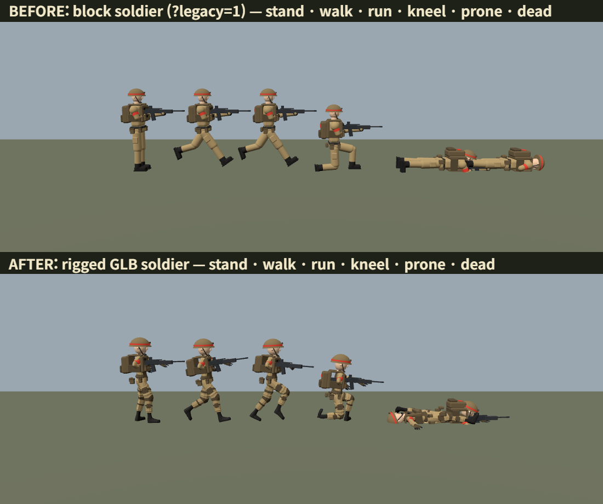
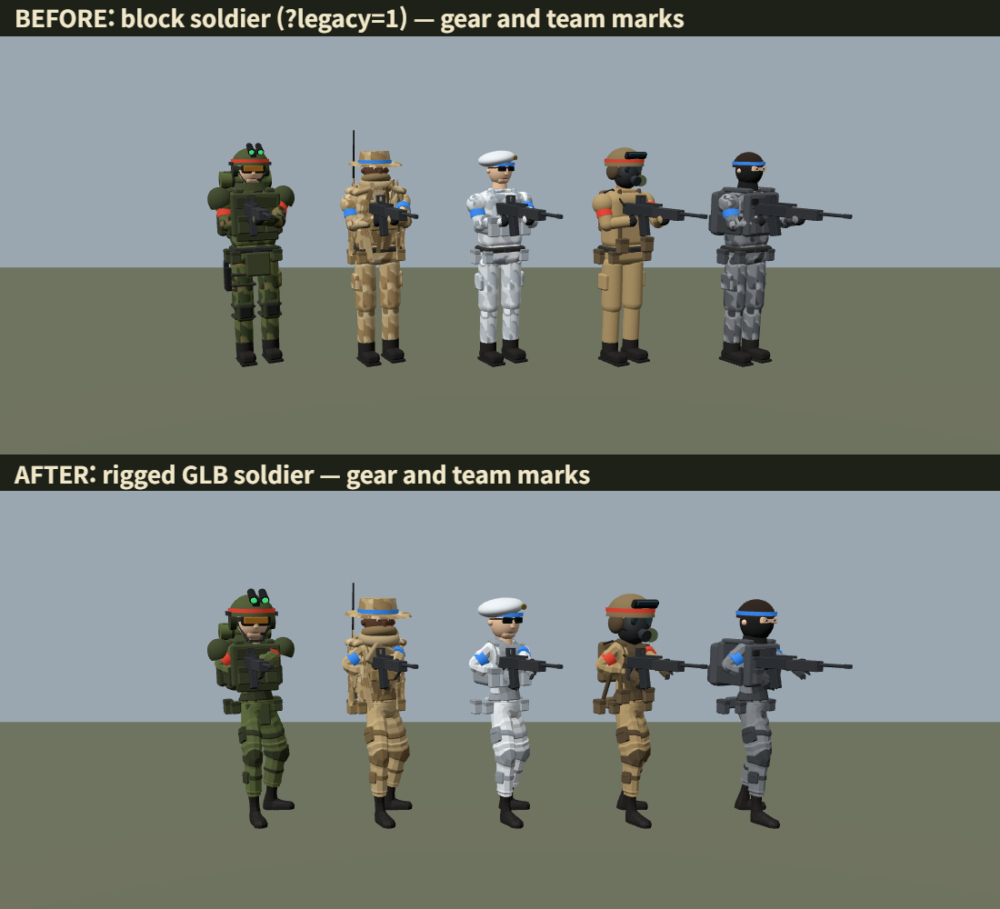

# 리그가 있는 GLB 병사

다른 플레이어를 기본 도형 조합 대신 **리그가 있는 GLB 모델**로 그립니다. 서버 물리·히트박스(`shared/physics.js`)와 1인칭 뷰모델(`outfit()`)은 건드리지 않았습니다.

## 모델
- **SWAT** by **Quaternius**: https://poly.pizza/m/Btfn3G5Xv4 (Quaternius "Ultimate Animated Character Pack" 수록)
- 라이선스: **CC0 1.0** (출처 표기 의무 없음)
- `public/models/soldier.glb`: **842 KB**, **7,752 삼각형**, 뼈 62개, 클립 9개 (Idle, Idle_Gun, Idle_Gun_Pointing, Walk, Run, Run_Shoot, Death, Gun_Shoot, HitRecieve)
  - 원본 1.5 MB에서 `tools/models/soldier.mjs`(gltf-transform)로 줄였습니다: 안 쓰는 클립 제거, weld/dedup/resample/prune, `KHR_mesh_quantization` 양자화. three.js가 기본으로 읽는 형식이라 디코더가 필요 없습니다.
  - 목표였던 5천 삼각형보다는 많지만 12명 기준 약 9만 삼각형이라 부담은 작습니다.

## 바뀐 것
- `public/soldierglb.js` (새 파일): GLTFLoader로 한 번 로드하고 플레이어마다 `SkeletonUtils.clone`으로 복제합니다. `AnimationMixer`가 속도에 따라 Idle/Walk/Run을 섞고(두 클립이 걸음 위상을 공유해서 발이 미끄러지지 않음, 뒤로 걸으면 역재생), 사망 시 Death를 한 번 재생합니다. 두 뼈 IK가 있습니다.
  - **앉기(s.cr=1)**: 모델에 Crouch 클립이 없어서 엉덩이를 내리고 다리 IK로 한쪽 무릎을 땅에 댑니다. 움직이면 낮은 자세로 걷습니다.
  - **엎드리기(s.cr=2)**: 지금처럼 그룹을 회전시키고, 목을 들고, 총은 앞을 향합니다.
  - **pitch**: 복부·몸통·가슴·목 뼈에 나눠서 회전하고, 나머지는 총 그룹이 맡습니다.
  - **벽 기대기**: `poseLean`이 block 병사에는 그대로 포즈를 주고, 리그 병사에는 `{ rear, side, low, wallFoot }` 값을 돌려줍니다(상체 기울이기, 앉아서 낮추기, 벽에 한 발 대기).
  - **총**: `u.aim`은 가슴 뼈에 붙어 있고, 양팔이 IK로 그립과 핸드가드를 잡습니다.
- `public/soldier.js`: `makeSoldier`, `setWeapon`, `disposeSoldier`의 이름과 사용법은 그대로입니다. 머리·헬멧·얼굴 장비는 head 뼈에, 조끼·배낭·벨트 파우치·등 패치는 torso 뼈에, 팀 밴드는 양쪽 위팔 뼈에 붙습니다. 위장/유니폼·장갑(맨손이면 피부색)·부츠 색이 머티리얼 색으로 들어갑니다. 모델 자체의 SWAT 헬멧은 숨기고 기존 머리를 씁니다. `disposeSoldier`는 mixer와 스켈레톤도 정리합니다(지오메트리는 템플릿과 공유되므로 템플릿 것은 남김).
- `client.js`: 원격 병사 애니메이션 분기, `warmUp` 전에 모델 로드를 기다림, 모델 로드 후 메뉴 초상화를 다시 그림. `character.js`: 모델을 기다린 뒤 미리보기를 그리고, 리그로 숨쉬기와 고개 돌리기를 합니다.
- importmap에 `three/addons/` 추가(index, character). 서버 MIME에 `.glb` 추가. smoke 테스트가 새 파일 두 개도 확인합니다.
- **대체 경로**: `?legacy=1`이거나 GLB나 애드온 로드에 실패하면 기존 block 병사를 씁니다. 파일을 일부러 404로 만들어서 확인했습니다.

## 확인한 것
- `npm test` 통과
- 로컬 서버 `MIN_PLAYERS=12`(봇 11명 + 나, `.claude/launch.json`의 `hanpan-bots`): 60 fps(vsync 상한), 콘솔 에러 없음. Practice vs bots도 60 fps.
- 리그 12개 update 합계 **프레임당 약 1.1 ms**, 병사 하나 생성 약 3.8 ms(기존처럼 프레임당 1명씩 생성)
- character.html: 헬멧, 조끼, 배낭을 바꿔도 파츠가 제자리에 붙습니다. 아이템 썸네일도 리그 병사로 그려지고, 빨강/파랑 팀 표시가 잘 보입니다.
- 서기/걷기/뛰기/앉기/앉아 걷기/엎드리기/사망/벽 기대기/위아래 보기를 포즈 그리드로 확인(위 이미지)

## 아직 어색한 부분
- **조준 팔 자세**: 고정된 상체 포즈에 IK로 손만 맞춘 것이라 팔꿈치 각도와 손목 비틀림이 어색할 때가 있고, 뛸 때도 총을 가슴 앞에 고정한 채로 뜁니다.
- **앉기**는 클립이 아니라 코드로 만든 자세라서 앉고 서는 전환이 단순한 보간입니다.
- 엎드려 기기는 Walk 클립을 천천히 돌린 것이라 실제로 기어가는 동작은 아닙니다.
- 머리는 기존 도형 머리를 붙였기 때문에 몸(로우폴리 모델)과 스타일이 살짝 다릅니다. 다리는 block 병사보다 가늘어 보입니다.
- 사망 시 총은 숨깁니다(바닥에 떨어뜨리는 연출은 없음).

## 다음 단계: Higgsfield/Meshy 커스텀 캐릭터로 바꾸기
1. Higgsfield 또는 Meshy에서 캐릭터를 만들고 **T-포즈로 리깅**합니다(Meshy auto-rig, 또는 Mixamo). Idle/Walk/Run/Death(가능하면 Crouch)를 붙여 GLB로 내보냅니다. 앞을 +Z, 키 약 1.8 m로 맞춥니다.
2. `node tools/models/soldier.mjs <in.glb> public/models/soldier.glb`로 줄입니다(`KEEP`에 클립 이름 추가). 목표는 5천~1만 삼각형, 3 MB 이하입니다.
3. `public/soldierglb.js`의 `MODEL`만 바꿉니다: `bones`(Mixamo라면 `mixamorigHips`, `mixamorigSpine1`, `mixamorigHead`, `mixamorigRightForeArm` …), `clips` 이름, `hide`(숨길 메시), `role`(메시나 머티리얼을 cloth/dark/boot/glove 중 무엇으로 칠할지), `walkSpeed`/`runSpeed`.
   - 주의: SWAT 모델은 발 뼈가 Root 아래에 따로 있습니다(IK 리그). Mixamo처럼 발이 다리 아래에 달린 리그라면 다리 IK의 foot 처리를 "발 뼈를 따로 옮기지 않기"로 조금 바꿔야 합니다.
4. `public/soldier.js`의 `FIT`(머리 높이/크기, 조끼 높이/비율, 총 높이)를 새 몸에 맞춰 조정합니다. 모델에 이미 얼굴과 헬멧이 있으면 `hide`를 비우고 HELMET/FACE를 헬멧 위에 얹는 쪽으로 정하면 됩니다.
5. Crouch 클립이 생기면 `update()`의 kneel IK 대신 크로스페이드로 바꿉니다.
